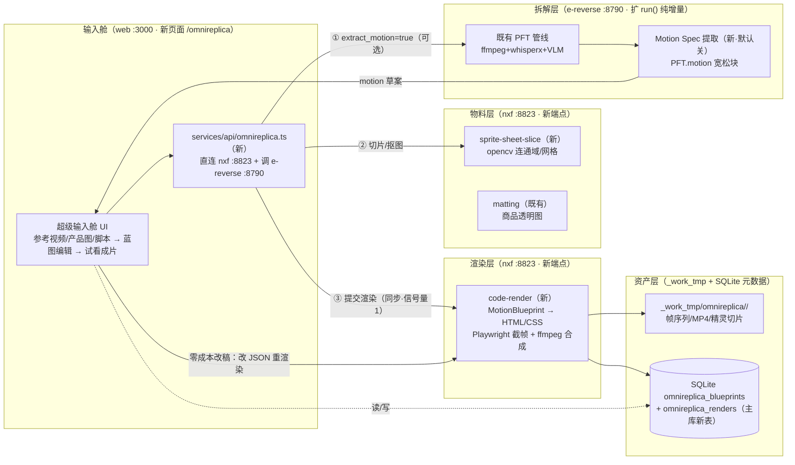

# 源起 · OiiOii「全能复刻」MVP — 项目交付方案 v1.2（待 Gemini 评审）

> **文档性质**：Phase 0 需求确认 + Phase 1 双轨产出（许可研·产品定义 v0.2 / 梁承宇·架构设计+增补一+增补二）的**主理人汇编终版**。
> **编写**：高屋建（全栈架构交付专家团主理人）· 2026-10-30 · 团队 `oiioii-omnireplica-mvp`
> **给 Gemini 的审核导航**：**§11 决策与权衡**（7 项主理人裁决，含被否方案）+ **§12 待确认清单**——这两节闭环后即可进 Phase 2 专项设计。
> **前置阅读**：《Phase 0 需求确认与架构侦察报告》（已审）；成员完整产出见 §14 索引。
>
> **v1.2 修订记录（2026-10-30 深夜，吸收梁承宇《增补二》）**：
> - **R4 持久化改 file-first（推翻 SQLite 方案）**：架构师发现 `services/api/user-data.ts` 是**云同步资产库**（踩「本地产出严禁外传」铁律），且入库路线需 Go 路由（破「Go 零改动」）——MVP 蓝图改存 `_work_tmp/omnireplica/<id>/blueprint.json`（nxf 资产端点 GET + 新增 PUT），列表扫 manifest，0 积分审计走 `render_log.jsonl`；SQLite 推迟为 E3（触发=跨会话强检索/多机同步/Go 路由可安全新增）；
> - **R7 E1 CDP 长连进 MVP（新增裁决）**：架构师诚实算术——子进程 t_frame 200~300ms → 改 1/3 镜头 ≈37~47s，**够不到 ≤30s**；E1（~100ms）→ ≈25s ✓。E1 与异步 job 合并工期 +1~2 人日，实现形态优先 Node 24 内置 WebSocket（保零新依赖）；
> - 对外承诺口径改为「改稿成本与变更镜头时长成正比（典型 3 倍速）」，「快 5 倍」与 E1 实测绑定，防过度承诺；
> - 新增：改稿影响提示双层触发（前端 debounce 预估 + nxf 建 job 权威 plan）+ 单一渲染按钮 + `ignore_cache` 入参；degraded 三机制落 schema（`shots[].degraded`）+ `motion-presets.ts` + edit_history 遥测；BGM 裁决 MVP 无声（音频 hash 只进 render_key 混音步，零时序耦合）；
> - 工期估计上调至 **12-15 人日**（E1 +1~2）。
>
> **v1.1 修订记录（2026-10-30 晚，吸收梁承宇《增补一》+ 许可研 v0.2）**：R3 改稿指标改公式化（镜头级帧缓存进 MVP）/ R5 异步 job+队列进 MVP / R6 输入边界+帧率裁决（W9+fps 24-30）/ MotionBlueprint v1.1 layer 字段 / M5 增加改稿影响提示 / motion_spec 漏返不兜底。

---

## 1. 一句话项目定义与成功标准

**在源起本地三件套上落地「参考视频 → 动效蓝图 → 精灵图物料 → 代码渲染成片 → 零成本改稿/多版本裂变」闭环；写实层（视频模型）本单占位，渲染/改稿路径 0 积分。**

| 成功标准 | MVP 硬指标（主理人校准后） | 测量 |
|---|---|---|
| 首稿效率 | 上传 → 480p 试看 P50 ≤ 10min | 漏斗时间戳 |
| **改稿周转** | **镜头级缓存公式**：T_改稿 ≈ T_全量 × (变更镜头时长/总时长) + ≤10s 固定开销（E1 目标 t_frame ≈100ms：480p 15s 全量 ≈44s，改 1 个 5s 镜头 ≈25s ✓；子进程兜底 t_frame 280ms：≈42s，≤30s 需 15fps 应急档）——对外承诺「成本与变更时长成正比（典型 3 倍速）」，「快 5 倍」与 E1 实测绑定，防过度承诺 | render_jobs 关联 revision + shot_cache_hits |
| 渲染质量 | 文字乱码 = 0（浏览器排版结构性保证）；切片成功率 ≥95%；渲染成功率 ≥98% | 抽检 OCR + job 状态聚合 |
| 蓝图质量 | 人工修正率 ≤20%（4 周后） | blueprint_versions diff |
| 成本硬不变量 | 渲染/改稿/裂变路径付费模型调用 = 0（credits_used 恒 0，可审计） | 调用审计对账 |

---

## 2. 需求范围（MoSCoW 汇编）

**Must（本单 7 项）**：M1 超级输入舱（参考视频 1~5 + 编号产品图 [1]~[5] + 结构化复刻指令模板 + 比例/清晰度/并发控制）；M2 动效蓝图拆解 + 可视化编辑 + **黄金片段选取**（e-reverse 扩 Motion Spec；时间窗 UI 可复用 `pages/ereverse/fragment-bar.tsx` 模式，后端边际成本≈0——侧车三端已建成）；M3 精灵图算子（BiRefNet → 透明底大图 → 切片坐标清单）；M4 Code2Video 渲染器（nxf 新端点：异步 job+队列、shot 级帧缓存、480p 试看 + 1080p 成片）；M5 零成本改稿闭环（变量化工程文件 + 改变量重渲染 0 积分 + **改稿影响提示**：点重渲染前展示「将重截哪些镜头/预计耗时/与全量对比」，复用 shot_key 差异计算零额外成本）；M6 工程持久化（蓝图版本历史 + 资产引用 + 历史成片）；M7 写实层占位（产品图 + 代码运镜，逐镜标注「包装镜头/实拍镜头」）。

**Should（工期允许）**：S1 多版本裂变（版本矩阵 + 批量队列）；S2 蓝图置信度标注（低置信镜头高亮 + 一键推荐补齐）；S4 精灵图跨工程复用；S5 渲染队列视图。**（S3 占位音轨已撤销——BGM 裁决 MVP 无声，见 R7）**

**可以延后（Could）**：C1 动效模板变体扩充（每类动效多版式）；C2 参考片 vs 成片逐镜对比视图；C3 工程导出/导入（跨机器迁移）；C4 4K 渲染参数（代码层能力上免费，需确认目标平台是否要求）；C5 15fps 应急试水档（改稿 ≤30s 的兜底路径，UI 明示画质代价；二期 audio 后混预留已并入 W4 表述，不占 Could）。**（C6 蓝图版本回退已定稿进 Must，见 §7）**

**Won't（9 项，各附理由）**：W1 画布 NodeToolbar/四联视图（Phase 4）；W2 写实层视频模型接入（二阶段）；W3 Real-ESRGAN 超分（**代码层分辨率自由，原生重渲染即高清，超分零收益**）；W4 AI BGM（**MVP 无声成片**——运营剪映自加是现有习惯；`audio_track` 只作 render_key 混音步预留，零时序耦合）；W5 VLM 直出 HTML/CSS（**抽卡破坏确定性，违背零成本改稿根基**）；W6 自动卡点；W7 多端协作；W8 从参考视频抠元素像素（版权，装饰走内置库+代码重绘）；**W9 URL 直贴竞品视频链接下载**（许可研提案、主理人确认：平台反爬/ToS 与内容合规风险不可控、需视频下载器与平台白名单运维，与「本地素材保私」核心目标无关；MVP 仅支持上传/本地路径——与 /ereverse 既有形态一致，用户习惯已成立）。

**关键范围裁决（主理人）**：黄金片段选区（00:00-00:11 钩子/核心转化段）**直接进 MVP**——`46f0d64` 已把侧车时间窗做完（裁剪+回正+32 项冒烟），对本单是免费能力（许可研 v0.1 中"建议 MVP 不做片段级"的判断基于过时信息，已修正）。

---

## 3. 系统架构

### 3.1 分层架构图



### 3.2 模块清单

| 模块 | 职责 | 仓库/文件 | 备注 |
|---|---|---|---|
| 输入舱页面 | 素材投喂、蓝图可视化编辑、试看/成片/改稿/裂变 | open-ai-canvas `web/src/pages/omnireplica/`（新目录） | 新路由 `/omnireplica`，lazy+RequireAuth，与 /ereverse 同工作台外壳 |
| 服务层 | nxf 直连客户端 + e-reverse 调用 + 错误人话化 | open-ai-canvas `web/src/services/api/omnireplica.ts`（新） | 复用 visual-dna.ts 的 NxfBridgeError 模式 |
| Motion Spec 提取 | 参考视频 → 动效草案（枚举词表强约束） | e-reverse `pft_schema.py`/`e_reverse.py`/`providers.py`/`server.py` | 纯增量，`extract_motion` 默认 false |
| 精灵图算子 | 大图 → 透明切片 + contact sheet 预览 | nxf `_engine/yingce_bridge/sprite_slice.py`（新） | opencv 连通域 + 网格双模式 |
| 渲染引擎 | Blueprint → HTML/CSS → 截帧 → MP4 | nxf `_engine/yingce_bridge/code_render.py` + `motion_blueprint.py`（新） | pydantic 强校验；幂等 render_key |
| 路由挂载 | 新端点 + 资产文件安全服务 | nxf `_engine/yingce_bridge/omnireplica_routes.py`（新 APIRouter） | **service.py 仅 +2 行**（import + include_router），`git add -p` 精确暂存 |
| Go 后端 | **本单零改动**（设计目标） | — | 0 积分旁路 = 不建 /api/tasks → 无 billingOrder |

### 3.3 与现有系统集成点

| 集成点 | 裁定 |
|---|---|
| `/api/tasks`（Go） | MVP 完全不复用；二阶段写实层回流时以 code-render MP4 作 `input.referenceVideos` |
| 积分 | 0 积分结构性成立（不建 Go 任务）；`omnireplica_renders.cost_microcredits=0` 旁路留痕，不碰计费测试 |
| 前端直连 nxf | CORS 白名单已含 127.0.0.1:3000，**无需改 vite.config**（C3 裁决） |
| e-reverse PFT | `motion` 块 optional + 默认关；`EreversePft` 类型同步 optional；`_smoke_test.py` 全绿才收工 |
| UI 探针 | 新页面是否进探针集 = §12 待确认（实测探针路由覆盖） |

---

## 4. 技术选型（含被否方案）

| 领域 | 主选 | 被否备选 | 否决理由 |
|---|---|---|---|
| 动画实现 | **纯 HTML/CSS Keyframes 声明式生成**（`:root` 自定义属性 + `@keyframes`；WAAPI 仅作截帧 pause/seek 控制） | ① GSAP；② 全量 WAAPI JS 动画；③ Remotion | ① 违零新依赖决策且命令式 API 与"蓝图可读可 diff"相悖；② 丢失 CSS 文本可审查性；③ React 渲染管线+node 重依赖，截帧链路换血 |
| 截帧通道 | **playwright-cli 子进程 + 持久 session**（`omni-<render_key[:8]>`，`--idle-timeout` 回收；每帧 eval seek→元素截图） | ① 自写 CDP 长连；② Python playwright 库 | ① 协议细节工程量大，列演进 E1（单帧实测 >300ms 即触发）；② venv 未装需下浏览器二进制，本机已有 CLI+msedge 零新增 |
| 资产存储 | **SQLite 元数据 + 文件系统重资产**（蓝图 JSON <200KB 入库；帧序列/MP4 落 `_work_tmp/omnireplica/`） | ① 全入库 blob；② 全文件系统 | ① MP4 序列数百 MB 入库 → WAL 膨胀备份灾难；② 蓝图检索/改稿历史/聚合查询弱 |
| 渲染任务模型 | **同步端点 + 服务端信号量（默认并发 1）** | 异步 job 轮询 | MVP 单机串行可满足；nxf 现有端点全无状态是架构纪律，列演进 E2（多人使用时） |
| Motion Spec 归属 | **e-reverse 扩 run()**（输入同源/降级同源/限流天然/不增第二套任务心智） | nxf 侧再调 VLM | 重复拉帧+重复付费+两份 provider 配置漂移 |
| 入口形态 | **新页面 /omnireplica + 侧边栏「定制模块」组入口** | ① 塞 /ereverse 第三模式；② CreatePage 入口 | ① /ereverse 已双模（解析+仿拍），第三模式认知负荷爆炸且职责混淆；② CreatePage 是上游核心页冲突面大，随后置 |

---

## 5. 数据模型摘要（v1.2 改 file-first，交储海量出资产目录规范）

**v1.2 关键修订**：原 SQLite 方案（`omnireplica_blueprints`/`omnireplica_renders` 两表+迁移 56）**作废**——架构师发现 `services/api/user-data.ts` 是云同步资产库（踩「本地产出严禁外传」铁律），且入库路线需 Go 路由（破「Go 零改动」设计目标）。MVP 改 **file-first**：

| 数据 | 位置 | 形态 |
|---|---|---|
| 蓝图本体（当前版） | `_work_tmp/omnireplica/<blueprint_id>/blueprint.json` | 经 nxf 资产端点 GET 读 + **新增 PUT 覆盖写**（16MB body 上限建议）；schema 层无 model/provider 字段 = 结构性无付费入口 |
| 蓝图版本快照 | 同目录 `versions/<render_key[:16]>.json`（≤100 个 FIFO） | 每次成功渲染自动落；回退 = GET 快照 → PUT 覆盖 blueprint.json（**复用两已有端点，零新增**，约 0.5 人日服务端） |
| 渲染登记+审计 | `_work_tmp/omnireplica/<id>/render_log.jsonl`（环形轮转上限待实测） | 每 job 一行：credits_used=0、cache_hits、wall_ms、stage_timings、degraded、browser/ffmpeg 版本 |
| 编辑遥测 | `edit_history.jsonl`（环形缓冲 100 条：字段/旧值/新值/时间戳） | 驱动 degraded 补齐率 + 修正率指标；敏感字段可配置脱敏 |
| 重资产 | `_work_tmp/omnireplica/<id>/shots/<shot_key>/frame_%06d.png` + `out.mp4` | 帧目录即缓存；成功后帧序列可配置即清（续截需 480p 重渲） |
| 蓝图列表 | 扫 `_work_tmp/omnireplica/*/manifest.json`（含 title/updated_at/last_render_key） | 免 DB；规模阈值见下 |

**演进 E3（推迟 SQLite 的触发条件）**：跨会话强检索/多机同步需求出现，或 Go 路由可安全新增时——届时入库 + manifest 兜底扫描保留。**迁移策略**：MVP 无 Schema 变更（CurrentSchemaVersion 维持 55），回滚 = 删资产目录。

---

## 6. 核心契约（精要，全文见梁承宇产出）

### 6.1 MotionBlueprint v1（零成本改稿的工程文件本体）

```jsonc
{
  "schema": "motion-blueprint/v1",
  "blueprint_id": "bp_ab12cd34",
  "meta": { "title": "...", "source": { "type": "manual | ereverse-motion", "ereverse_job_id": "?" },
            "provenance": { "generator": "omnireplica-mvp/0.1", "degraded": [] } },
  "canvas": { "width": 1080, "height": 1920, "fps": 30, "duration_ms": 15000,
              "background": { "type": "solid | sequence", "solid": "#0B0B12", "sequence": [{ "at_ms": 0, "color": "#FFF" }] } },
  "theme": { "colors": { "primary": "@…", "text": "#FFF" }, "fonts": { "title": "msyhbd.ttc" }, "title_size_ratio": 0.075 },
  "slots": { "product_main": { "kind": "product_image | sprite", "url": "data:…|file://…", "fit": "contain", "sprite": { "slice_index": 0, "frame_count": 12, "fps": 12 } } },
  "shots": [ { "shot_id": "shot_1", "start_ms": 0, "end_ms": 3000,
               "enter": { "type": "fade-up", "duration_ms": 400, "easing": "ease-out" },
               "exit":  { "type": "fade", "duration_ms": 300 },
               "elements": [ { "element_id": "title_1", "type": "text | image | sprite", "slot": "product_main?",
                               "text": "家人们谁懂啊", "position": { "x": 0.5, "y": 0.18 }, "size_ratio": 0.08,
                               "color": "@theme.colors.primary", "stroke": { "color": "@theme.colors.stroke", "width_ratio": 0.006 },
                               "enter": { "type": "pop", "duration_ms": 300, "delay_ms": 200 } } ] } ],
  "transitions": [ { "after_shot": "shot_1", "type": "dip-to-white", "duration_ms": 200 } ]
}
```

**动效枚举（全部可纯 CSS 实现，集合外 → 422 或映射 none+degraded）**：enter `none|fade|fade-up|fade-down|slide-left|slide-right|zoom-in|zoom-out|pop|flip-x|blur-in`；exit `none|fade|fade-down|scale-down|slide-left|slide-right`；transition `none|cut|dip-to-white|dip-to-black|cross-fade`；精灵图 = `background-position + steps(N)` 序列帧（零 JS）。
**换肤零成本关键路径**：`@theme.*` 引用渲染时注入 `:root` CSS 自定义属性——改配色只改 theme 块。

### 6.2 nxf 新端点

| 端点 | 入参精要 | 出参精要 |
|---|---|---|
| `POST /api/v1/ecommerce/vision/sprite-sheet-slice` | `image`（data/路径/http，复用 SSRF 守卫+回环白名单例外）、`rows`/`cols` 或 `auto_detect_connected_components`、`padding=4`、`trim_alpha=true`、`max_slices=64` | `slices[]`（index/bbox/url）、`preview_png` contact sheet、`degraded`（如"连通域 0 片回退网格"）、`elapsed_ms`；失败 HTTP 200+`ok:false`+error_code |
| `POST /api/v1/video/code-render` | `blueprint`（pydantic 强校验，422 到字段路径）、`assets_override`（高清换产品图专用）、`resolution`（480p/720p/1080p，短边对齐+比例锁定）、`fps`、`idempotency_key` | `render_key`（sha256：canonical blueprint+资产 hash+res+fps+encoder）、`cached`、`video_url`、`stage_timings{html,capture,encode}`、`degraded`/`warnings`；**任何阶段失败不返回假视频**（断点续截：frames_dir 保留） |
| `POST /api/v1/video/code-render/batch` | `blueprint` + `variations[]`（每版变量差集，如 theme/title/asset_overrides）+ `resolution`/`fps` | `{batch_id, jobs: [{job_id, plan: {recapture_count, reuse_count, estimated_ms, full_render_ms}}]}`——**提交即见每版渲染计划（裂变预报价）**；服务端 FIFO 串行；进行态走各 job status fan-out 轮询，无 batch 聚合端点 |

### 6.3 渲染确定性四铁律（梁承宇）

1. `render_key = sha256(canonical blueprint + 各 slot 资产内容 hash + resolution + fps + encoder_profile)`，存在即 `cached:true`；
2. 编码参数全固定（libx264 veryfast crf20 yuv420p）；浏览器/ffmpeg/字体版本登记 `engine`+`provenance`——**同机同浏览器帧级确定，不承诺跨环境字节一致**（文档明示）；
3. seek 握手：`document.getAnimations().forEach(pause+currentTime=t)` + 双 rAF 刷新后才截图，杜绝帧错位；首末帧像素校验和异常即失败；
4. HTML 注入防护：blueprint 全部文本字段 HTML-escape 后注入；恶意 blueprint 单测（`</script>`）。

---

## 7. 实现要点（分层）

**输入舱（颜可心设计）**：左参考视频卡（缩略图+「参考视频」角标，1~5 个切换）｜右编号产品图带（[1]~[5]，上传即调 matting 预提透明底缓存）｜结构化指令模板（可编辑：「参考已上传的视频，制作一条 [主题] 产品展示视频。保留原视频的画幅、时长、页面布局、大标题排版、镜头顺序、产品切换方式、转场节奏及元素运动效果。【产品替换】将原视频中的主体全部替换为我上传图片 [1-5] 中的产品。」）｜底部控制栏（引擎/清晰度/并发+发送）。蓝图编辑器 = JSON 可视化表单（theme 换肤区高亮「改这里=零成本」）+ 低置信镜头高亮。

**改稿影响提示（US-6 终稿，v0.3+v0.5）**：单一「渲染」按钮，点前常驻三条——① **将重截哪些镜头**（镜头编号+缩略图，含命中缓存的「复用」徽标）；② **预计耗时**（本地公式预估+「节省 67%」对比条：如改 1 个 5s/15s 镜头 ≈ 付 1/3 成本）；③ **缓存依据**（引用哪次渲染的哪些帧，nxf 权威 plan 回填）。**判定规则（前后端同源，按 outcome 不按 cause）**：判定序 1 全局作用域字段（canvas.width/height/fps/duration_ms/background.*/transitions[]/resolution/fps/引擎与字体版本）任一变化→全局分支；序 2 逐镜头算 shot_key 与上次渲染快照比对——全未命中→全局、部分未命中→局部、全命中→零变更；theme 按 outcome 走（只废真引用被改变量的镜头）；引擎/字体版本静默变化时全局文案追加「（渲染引擎版本已变化）」不静默；实时预估层与权威确认层共用 `versions/` 快照基线（{render_key, resolution, fps, blueprint} 自包含），前端 debounce 300ms、后端建 job 时算权威 plan。**零积分世界的可感知货币是时间——影响条即实时报价器。**

**裂变进度（US-7 终稿，v0.5+v1.1）**：**省时间叙事三件套**（产品原则，约束后续任何新展示——不得引入第二套耗时口径）：① 影响条=单版实时报价 → ② **批量提交即见计划=裂变预报价** → ③ 进行态逐版进度=实时折现；全部数据同一 plan 源、前后端同源。机制：a) **提交即可见**——batch POST 响应丰富为 `{batch_id, jobs: [{job_id, plan: {recapture_count, reuse_count, estimated_ms, full_render_ms}}]}`（渲染计划建 job 时算出，权威层本来就要算），用户点完「批量裂变」立即看到每版「重截 N 镜头/命中缓存 M 镜头/预计 ≈Xs（全量 ≈Ys）」，无需等轮询；b) **进行态零新端点**——每版进度走各 job status（frames_done/total+plan），前端 fan-out 轮询（本地回环 12 版 × 1 请求/2s 无压力），batch 聚合端点不做（v1.0 后有性能证据再说）。时间预期按 worst case 报价（12 版 480p@24fps ≈9min 全不共享镜头），典型同蓝图裂变多数镜头命中缓存、实际明显更快——「省钱」以「省时间」形式实时可见；「直出高清」= batch 参数切 1080p@30fps（零新机制，每版 ≈2min 明示）。**架构治理纪律（梁承宇，随终版立规）**：所有耗时/缓存展示的唯一数据源是渲染计划 `plan`（recapture_count/reuse_count/estimated_ms/full_render_ms）——任何新增耗时相关 UI 必须从 plan 派生，**禁止引入第二套计时口径**（同时防前后端口径漂移与未来另起炉灶）。

**拆解层（安智体 prompt 策略）**：`extract_motion=true` 时 VLM prompt 增动效维度（分镜时间点/大标题文本/动效类型**必须落在枚举词表**）；词表外映射 none + degraded 登记；漏返字段扁平兜底（同 prompt_slots 既有策略）；产出挂 PFT.motion 宽松块，前端装配为 MotionBlueprint（**模板给默认值、VLM 只填槽**——§11-R1 裁决）。

**物料层**：sprite-sheet-slice 双模式（网格手填/连通域自动）+ 预览回传人工确认；商品图走既有 matting。

**渲染层**：blueprint_to_html（theme→:root 变量；元素→绝对定位 div；enter/exit→@keyframes；sprite→steps() 序列帧；文本全 escape；末尾注入 seek 握手脚本）→ **E1 CDP 持久连接逐帧**（Node 24 内置 WebSocket 单 ws，Runtime.evaluate 批量 seek + Page.captureScreenshot 流式回传；目标 t_frame ≈100ms；子进程 playwright-cli 为兜底降级路径）→ ffmpeg image2→libx264。**异步 job 模型**：POST 提交→job_id/queued；ThreadPoolExecutor+FIFO 串行（默认并发 1~2 可配，code-render 是 CPU/RAM 密集不是网络 IO 密集，不克隆 /api/tasks 的 1~8）；GET status 带 frames_done/total+queue_position；batch 端点同蓝图+变量列表；内存峰值预算 ≈1.1GB/渲染【待实测校准】；`render_log.jsonl` 每 job 一行审计（credits_used=0+cache_hits+stage_timings+degraded+引擎版本）。

**工程闭环（v1.2 增补）**：① **蓝图版本回退（Must，US-3 终稿）**——每次成功渲染自动落 `versions/<render_key[:16]>.json` 快照（≤100 FIFO），蓝图页版本列表展示（render_key 短号+时间+来源标签）→选中「回退到此版本」→GET 快照→PUT 覆盖 blueprint.json（复用两已有端点零新增，约 0.5 人日）；三界限明示：渲染时点粒度/回退后死引用文件给明确警告不静默/超 100 自动淘汰最旧。② **一键推荐动效（degraded 三机制核心）**——3 个预置整镜模板（口播条/产品特写/氛围过场，静态 CSS 可过 nxf preset 回归），试看后一键「按推荐值补齐全部待确认项」；**上线门槛：三模板须先过 nxf preset 回归测试才向运营开放**（M2/M3 门禁，防模板错误放大成片缺陷）。③ **degraded 渲染不拒绝**——code-render 不因 degraded 拒绝渲染（静态占位+时间轴角标），推荐值采纳是人工决策；`edit_history.jsonl`（环形 100 条）驱动「degraded 补齐率」周指标（目标一周 ≥80% 工程清零或显式接受）。④ **BGM MVP 无声**——`audio_track` 字段只进 render_key 混音步预留，零时序耦合；运营剪映自加（W4）。

**人机边界（许可研）**：切镜/ASR/抠图/切片/渲染/合成 = 确定性代码；动效蓝图结构化 = VLM（schema 校验失败→降级单镜通用模板+人工编辑；**motion_spec 漏返/半返→不兜底组装、degraded 显式登记**——动效猜错比没有更糟，人工编辑是设计内的正常路径）；镜头分类 = VLM 判定+规则兜底（含大字/UI/贴纸→包装镜头）+ 人工可改；改稿/裂变矩阵/质量终审 = 人工。**degraded 三机制**（v0.2）：低置信镜头预览角标「建议人工确认」+ 试看后一键「按推荐值补齐全部待确认项」+ 「degraded 补齐率」进指标（目标：一周内 ≥80% 工程的 degraded 清零或显式接受）。

---

## 8. 里程碑与排期（人力假设：1 名全栈 + 成员兼职评审）

| 里程碑 | 内容 | 依赖 | 工期估计【假设】 | 验收 |
|---|---|---|---|---|
| M0 契约冻结 | §12 待确认闭环；MotionBlueprint v1.2 schema + 两端点契约 + 异步 job/batch API + 蓝图 PUT/版本快照契约冻结 | Gemini 评审通过 | 0.5 人日 | schema 冻结版入仓 |
| M1 引擎打通 | nxf sprite_slice + code_render（shot_key 幂等/缓存命中 + E1 CDP 长连 + 异步 job 队列 + 版本快照落盘）+ routes；联调实测单帧延迟/总 wall | M0 | 4-6 人日 | 端到端跑通「大字标题+产品图+精灵飞入」480p MP4；stage_timings 回填；t_frame 实测数据回填公式；改同蓝图重渲染 cached:true 零重截 |
| M2 拆解接入 | e-reverse Motion Spec（纯增量，v1.1 layer 字段）+ 安智体 prompt 词表（不做兜底组装）+ 3 个预置整镜模板（口播条/产品特写/氛围过场）+ **preset 回归测试** + /omnireplica 页面骨架+输入舱 | M1 | 2 人日 | 参考视频→蓝图 JSON 人工可读可改；黄金片段选区可用；layer 默认 code；**三模板过 nxf preset 回归（一键推荐开放的前置门槛）** |
| M3 改稿闭环 | 工程持久化（file-first：blueprint.json+versions+manifest+render_log+edit_history）+ 蓝图可视化编辑 + 影响条（三层+判定规则）+ 版本回退 UI + 0 积分三层落地 + 队列/批量 UI | M2 | 2.5-3 人日 | 换标题/配色命中缓存；影响条预估与权威 plan 一致；回退到旧版本成功；credits_used=0 对账 |
| M4 裂变+门禁 | 多版本批量收尾（含按版本进度展示）+ tsc/bun test/探针/nxf pytest 全绿 + 验收报告 | M3 | 1.5 人日 | 一条爆款出 3 节日版本；门禁全绿提交 |

**关键路径**：M0 → M1 → M2 → M3 → M4（串行，总计约 **12-15 人日**【假设：无阻塞、单工作站、联调顺利；+异步 job 1 / +镜头级缓存 1~2 / +E1 CDP 1~2】）。
**演进项**：写实层二阶段（2-3 人日）；画布 NodeToolbar（Phase 4，3 人日）；SQLite 收编（E3：跨会话强检索/多机同步/Go 路由可安全新增时触发）；CDP→?（若 E1 实测仍不达标，考虑服务端合成路线——留给架构师）。**原 E1/E2/E3 已全部升格进 MVP 或改判（E1 进 MVP / E2 进 MVP / E3 推迟为 SQLite 触发条件）。**

---

## 9. 测试与验收清单

**门禁（既有体系，本单不得破）**：`tsc --noEmit` 0 error；`bun test` 全绿（新增 `test/omnireplica-*.test.ts`：blueprint→HTML 纯函数、URL 拼装、HTML-escape 恶意注入、幂等 render_key）；UI 探针（新页面进探针集待 §12 确认）；**nxf 侧新增 `test_sprite_slice.py`/`test_code_render.py`（沿用 smoke_birefnet 无头自检，合成 1s 测试视频端到端）**；Go 后端零改动 → Go 测试零影响（设计目标，变更即报警）。

**三件套自测（施工令阶段五要求）**：
1. `sprite-sheet-slice`：多元素食材/道具大图 → 切出独立透明 PNG（网格+连通域双模式各一次）；
2. `code-render`：3 张产品透明图 + 精灵图 + 大字标题 → 本地合成矢量文字清晰、动效丝滑的 480p/1080p MP4；
3. **零成本改稿**：改标题文案与节日配色 → 验证**无任何外部模型调用**、镜头级缓存命中（非变更镜头零重截）、除变更变量外逐帧一致（像素校验和）；
4. **蓝图版本回退**：渲染 v1→改蓝图→渲染 v2→回退 v1→再渲染，验证帧级与 v1 一致且快照 FIFO/死引用警告生效；
5. **preset 回归（一键推荐开放门槛）**：3 个预置整镜模板（口播条/产品特写/氛围过场）各渲一次，逐帧人工+断言双验，不过不开放。

**探针加栏建议**（提交 qa 评审）：`/omnireplica` 页 G0~G19 既有断言外，新增「0 积分徽标存在」「蓝图编辑器可达」「试看按钮实心可见」「影响条三层常驻」「批量进度按版本展示」五项轻断言。

**验收基线（15s 片长，梁承宇定稿，联调实测回填校准）**：

| 档位 | 帧数 | E1 达标（t_frame ≤100ms） | 未达标（200-300ms） | 应急 |
|---|---|---|---|---|
| 480p@24fps（试水默认） | 360 | 全量 ≈44s；1/3 镜头改稿 ≈25s **≤30s ✓** | 全量 ≈80-116s；改稿 ≈37-47s ✗ | 降 15fps：240 帧，全量 ≈32-80s |
| 1080p@30fps（高清重渲） | 450 | 全量 ≈53s（高清本就是全量语义，无改稿指标） | ≈98-143s | 同降 15fps |
| 15fps（应急试水） | 240 | 全量 ≈32s；1/3 改稿 ≈18s ✓ | ≈56-80s | — |

公式：`T_改稿 = N_frames × t_frame × (Σ变更镜头时长/总时长) + ≤10s 固定开销`；对外承诺：「成本与变更镜头时长成正比，典型约 3 倍速；变更 ≤20% 且 E1 达标时约 5 倍」（R7 绑定不变）。**t_frame 是联调第一优先实测项——它直接决定 E1 验收线（≤100ms）与头条指标 ≤30s 的成败。**

---

## 10. 部署与运行方案

- **形态**：绑定现有 D:/AlcheMvision 工作站单机部署（三件套 + playwright-cli + msedge + ffmpeg + WhisperX + BiRefNet 权重已就位）；运营经内网访问 web :3000。【待确认：并发运营数】
- **启动编排**：复用 yuanqi_console（:17580）服务管理——nxf 已在册（:8823），新增 omnireplica 无需新服务进程（挂在 nxf 内）；控制台 health 卡可加 nxf omnireplica 引擎自检（ playwright/ffmpeg/字体）。
- **回滚**：新表 drop + nxf 新文件移除 + router 注销；渲染资产目录可整目录删除（无外部依赖）。
- **监控**：render_jobs stage_timings + 失败 stage 登记进 SQLite；health 端点自检引擎就绪；磁盘配额登记（帧序列 100-800MB/次）。

---

## 11. 风险清单（产品+技术合并，按影响排序）

| 风险 | 概率 | 影响 | 应对 |
|---|---|---|---|
| VLM 动效蓝图准确度不足（切镜边界错/文字识别错/动效误判） | 高 | 高 | 蓝图定位"可编辑草稿"非终态；枚举词表强约束+集合外映射 none+degraded；置信度低亮；ASR 词级对齐辅助；以修正率数据驱动 prompt 迭代（安智体） |
| **playwright 单帧延迟超预算**（子进程启动开销） | 中 | 高 | 持久 session 摊薄；首日实测；>300ms 即 E1 CDP 长连；兜底降 fps 15+degraded 登记 |
| seek-截图时序竞态（帧错位/画面撕裂） | 中 | 高 | 双 rAF 握手；首末帧像素校验和；异常即失败不交付 |
| 无头 msedge 中文字体缺字形 | 低 | 高 | 字体白名单（msyh/msyhbd/simhei）启动自检进 health；引用不存在字体→422 明报不静默替换 |
| 动效模板库冷启动质量差（成片"廉价感"） | 中 | 中 | MVP 限定 2-3 类已验证版式（口播大字报/产品特写贴纸/场景氛围包装）人工精修；案例沉淀驱动扩充 |
| 精灵图连通域误检（过切/漏切） | 中 | 中 | max_slices 上限；0 片回退网格；contact sheet 人工确认；网格参数始终可手填 |
| 改稿周转不达标（全量重截帧慢） | 中 | 中 | MVP 指标按 120s/180s 校准；E3 镜头级缓存作触发器；stage_timings 数据说话 |
| 大 asset data URL 传输失败 | 中 | 中 | nxf 请求体 64MB 上限；MAX_WORK_PIXELS 预缩放；超大资产落盘 file 引用 |
| nxf 仓库提交冲突（他人 WIP） | 中 | 中 | 四个新文件+service.py 2 行；`git add -p` 精确暂存；提交前 git status 双人核对 |
| e-reverse 扩展回归 | 低 | 中 | motion 纯增量+默认关+既有字段零改；`_smoke_test.py` 全绿 |
| 版权合规（复刻他人爆款） | 中 | 高 | 定位"复刻动效结构不搬运内容像素"；不从参考视频抠元素；输入页/成片结构参考提示；水印策略待法务 |
| 指标承诺过度（≤30s 与「快 5 倍」依赖 E1 与 t_frame 实测，首版 t_frame >200ms 即穿帮） | 中 | 高（信任） | 承诺文案校准「成本与变更镜头时长成正比，典型约 3 倍速；5 倍与 E1 绑定」；看板标注 E1 依赖与折算系数；未达标按第 5 章降级路径执行（≤50s 或 15fps 档），不硬撑 |
| 小白理解成本（代码层 vs 写实层） | 中 | 低 | 产品语言「包装镜头/实拍镜头」；预览逐镜标注；实拍默认占位并明示二阶段可补 |

---

## 12. 决策与权衡（主理人裁决，Gemini 如异议请提出）

**R1 · Motion Spec = 模板给默认 + VLM 只填槽（裁决）**。采纳梁承宇「e-reverse 扩 run() 动效草案 + 枚举词表」载体，但明确 MVP 语义是**词表约束下的填槽**而非自由生成——模板参数化引擎保底（未知动效→匹配最近模板+标记），VLM 输出只覆盖其高置信字段。**被否**：VLM 多帧联合分析直出事件序列（保真度高但输出不稳定、prompt 工程深，列二期 E4）；VLM 直出 HTML/CSS（抽卡破坏确定性，W5）。

**R2 · 入口 = 新页面 /omnireplica + 侧边栏入口（裁决）**。**被否**：塞 /ereverse 第三模式（页面已双模，认知负荷爆炸+职责混淆——ereverse 管"拆解与单镜头换装"，omnireplica 管"整片代码级复刻"，两者互补并列）；CreatePage 入口（上游核心页冲突面大，随后置）。

**R3 · 镜头级帧缓存进 MVP，改稿指标公式化（v1.1 修订裁决）**。v1 我曾裁决「全量重渲染+指标 120s/180s、镜头级缓存列 E3」；**梁承宇《增补一》用完整设计推翻了我的保守裁决**——关键洞察：`shot_key` 必须先把 `@theme.*` 解析为实际值再 hash（换肤才不误伤缓存），且主题只有一套运行时值，多主题缓存等同废弃。采纳其设计：变更分类（局部=主题/文本/slot/该 shot 动效参数；全局=时长/fps/画布/镜头边界/转场）→ 局部只重渲染命中 shot（非命中 shot 连 HTML 都不生成）→ 帧目录即缓存（`_work_tmp/omnireplica/<bp>/shots/<shot_key>/`）+ `manifest.json` 装配（缺失帧→仅补该 shot）+ 成功删帧保 MP4（续截需 480p 重渲）。**验收口径改为公式**：T_改稿 ≈ T_全量 ×（变更镜头时长/总时长）+ ≤10s 固定开销；「改 1 个 5s 镜头 ≈ 付 1/3 全量成本」体感无条件成立；≤30s 为**有条件目标**（短镜头变更 + t_frame ≤200ms + 试水 15fps）而非无条件承诺。**被否**：① 只缓存非变更 shot 的帧（缓存集合=全量-变更，与架构师方案等价但表述绕）；② v1 的全量重渲染+120s 保守口径（浪费架构师已验证的可行性，且丢掉「裂变经济性」卖点——圣诞/元旦/七夕 3 版若只改 theme+标题，理想情况只重渲染含标题镜头）。**新增硬风险**：shot_key 漏依赖导致缓存误用（把别人的帧缝进新片——比慢更严重），靠「局部变更集合显式枚举+越界即全局」的强约束兜底。

**R4 · 工程文件入库（SQLite 新表），不走 .local manifest（裁决）**。采纳梁承宇方案：改稿历史/列表/按来源聚合是核心诉求，manifest 很快不够用；新增表（不改现有表）迁移风险低，Schema 55→56 由储海量出 DDL；v1.1 增补：`omnireplica_renders` 加 CHECK 约束 `credits_used=0` 且 `go_task_id IS NULL`（0 积分的自证据）+ render_log.jsonl 旁路审计。**被否**：.local+manifest 免迁移快跑（检索弱，M3 改稿闭环就要返工）。

**R6 · 输入边界与帧率（v1.1 增补裁决）**。① **W9 URL 直贴列入 Won't**（理由见 §2）；MVP 输入 = 上传/本地路径，与 /ereverse 既有形态一致。② **fps 可配 24/30**：480p 试水默认 24fps（截帧量 -20%，服务「改 1 个 5s 镜头 ≈ 付 1/3 成本」体感），成片默认 30fps（交付口径统一，抖音/视频号信息流标准）；公式分母按当次 fps 计算，UI 明示「fps 越高改稿越慢」。——回应许可研标为 HIGH 的待确认 #2：帧率是改稿公式分母，必须在 MVP 内可解释、可选择，不做死。

**R5 · 异步 job + 队列 + batch 端点进 MVP（v1.1 修订裁决）**。v1 我曾裁决「同步+信号量、E2 后置」；梁承宇论证：同步 180s+ 请求必然撞网关超时，且产品硬约束 4 明确要求埋点收口 nxf 与队列/重试/并发上限——**E2 提前是本单硬需求而非演进**。采纳：POST 提交→`job_id`/queued；GET status 带 `frames_done/frames_total` + `queue_position`；POST `/api/v1/video/code-render/batch`（同蓝图+变量列表=裂变矩阵，服务端 FIFO 串行，**不克隆 /api/tasks 的 1~8 并发**——那是网络 IO 密集型，code-render 是 CPU/RAM 密集，单渲染峰值≈1.1GB，默认并发 1~2 可配）；ThreadPoolExecutor+FIFO+目录创建即入队；`render_log.jsonl` 每 job 一行结构化审计（含 credits_used=0 与 cache_hits）；job 表仅在内存（nxf 无状态纪律不破），重启→404→前端诚实提示+shot-cache 续截红利。**被否**：同步长连接（超时必炸）；入库 job 表（破无状态纪律）。

**R7 · E1 CDP 长连进 MVP + 指标承诺口径（v1.2 裁决）**。梁承宇诚实算术：子进程 t_frame 200~300ms → 480p 15s 全量 80~116s、改 1/3 镜头 37~47s，**够不到 ≤30s 改稿承诺**；E1（CDP 持久连接，目标 t_frame ≈100ms）→ 全量 ≈44s、改 1/3 ≈25s ✓。裁决：**E1 进 MVP**（实现形态优先 Node 24 内置 WebSocket，保零新依赖；子进程路径保留为兜底降级），与异步 job 合并工期 +1~2 人日。**对外承诺口径**：「改稿成本与变更镜头时长成正比（典型 3 倍速）」；「快 5 倍」与 E1 实测绑定，**防过度承诺**（竞品口径=其平台数据，非我方承诺）。**被否**：① MVP 只用子进程+公式兜底（丢核心卖点体验）；② 对外照搬「5 倍」（实测未证）。

---

## 13. 待确认清单（按决策方，Phase 1 收口态）

**已裁决归档（不再讨论，Gemini 复核即可）**：fps 24/30（R6）｜URL 直贴 Won't（W9）｜BGM MVP 无声（W4）｜蓝图版本回退进 Must（§7）｜异步 job+E1 进 MVP（R5/R7）｜持久化 file-first（R4 修订）｜黄金片段进 MVP｜preset 回归门槛（§9）｜「省时间叙事三件套」+ plan 唯一数据源治理纪律（§7）。

**请 Gemini 裁决**：§11 七项主理人裁决（R1 模板填槽 / R2 入口 / R3 镜头级缓存+公式 / R4 file-first / R5 异步 job / R6 fps+W9 / R7 E1+承诺口径）逐项是否认可？重点三项：R3 公式化验收口径、R7 E1 进 MVP 与「3 倍速典型/5 倍与 E1 绑定」承诺文案、R4 file-first（推翻原 SQLite 路线，因 user-data.ts 云同步踩铁律+Go 零改动）。

**请主人确认（基线类，不阻塞 M0 契约冻结与 M1 引擎开发）**：
1. **动效模板库冷启动**：2-3 类版式的参考爆款视频由主人提供（`项目/` 目录 14 个 mp4）还是先用通用电商骨架？
2. `ai-表演实验室` 155 文件删除：误删（restore）还是 intentional 收敛（提交）？
3. **首批用户画像**：几人/是否纯内部/剪映熟练度（影响模板库范围与新手引导）；
4. **规格边界（v1.2 已拟草案，待架构确认 PUT 分层）**：参考视频 ≤5 个/单文件 ≤1GB/时长 ≤120s；比例集合不限（UI 主显 9:16/1:1/16:9，其余可输入）；产品图 ≤5 张/单 ≤10MB（9:16/1:1/4:3，超出即前端提示）；
5. **写实层占位表达**：默认「产品图+代码运镜」可否接受，还是需要显式占位帧+「第二阶段补实拍」标注？
6. **指标基线**：现有剪映流程复刻/改稿时长基线（支撑「3 倍速」对比口径）；e-reverse VLM 现准确度与耗时基线；
7. **VLM 成本口径（v1.2 已拟草案，待主理人采纳）**：MVP 默认**本地优先**（HfLocal/Ollama，0 积分）——e-reverse 既有默认 auto 链是「智谱→Gemini→Ollama→HfLocal」，omnireplica 入口改默认本地优先（HfLocal/Ollama）；Gemini 需用户显式选择+界面明示（「走本机中转，不经我方计费」）；智谱默认关闭（需外部 key）；「0 积分」边界表述：**渲染/改稿/裂变路径恒 0（硬不变量）**；拆解默认本地后端=0，选 Gemini/智谱时如实明示成本归属；
8. **版权灰度**：默认禁止一切从参考视频提取像素（建议是）+ 水印策略 + 法务边界；
9. **部署形态**：单工作站串行 vs 内网多运营并发（影响 E2 优先级与队列上限设计）；
10. **4K 是否需要**：目标平台是否要求 4K 成片（C4）；
11. **批量命名规范与交付目录结构**：裂变版本命名规则与落盘结构。

**联调实测（M1 首日数据回填，不编造）**：① **t_frame 实测（第一优先）**——决定 E1 验收线（≤100ms）与头条指标 ≤30s 成败；② `screenshot "#stage"` 元素截图精确边界行为（transform 影响）；③ 本机物理内存/磁盘余量（校准并发上限 1~2 与配额）；④ render_log.jsonl 轮转上限（建议 10MB×3）；⑤ 蓝图 PUT body 上限确认（建议 16MB）；⑥ `OMNIREPLICA_ASSET_ROOT` 最终路径确认；⑦ UI 探针路由覆盖范围（新页面是否需主动进探针集）。

---

## 14. 附录：Phase 1 成员产出索引（均已冻结）

- **许可研《全能复刻 MVP 产品定义》**：v0.1 → v0.5 五轮增量 + **v1.0 合并清洁版（2026-10-30 终版）**：3 场景/10 段旅程/8 用户故事（US-1~8 终稿）/MoSCoW Must 7+Should 4+Could 5+Won't 9/人机边界 12 环节/15 指标埋点/6+1 风险/10 基线类待确认 + v1.1 修订 18（US-7 批量进度两机制）。US-6 交互三件套、US-3 版本回退三界限、degraded 三机制、preset 上线门槛均已与架构对齐。（全文见团队消息记录）
- **梁承宇《全能复刻 MVP 架构设计》**：主文档（分层架构/MotionBlueprint v1→v1.2/动效枚举/端点契约/边界裁决/非功能性/冲突面 C1-C5）+ **《增补一》**（镜头级帧缓存完整设计/异步 job+batch/0 积分三层/v1.1 字段/片段级仓库实证）+ **《增补二》**（file-first 持久化修订/US-6 交互拆解/degraded 三机制架构配合/E1 提前论证/BGM 无声/版本回退定稿）+ **终版确认**（fps 锁定零契约变动/验收基线表定稿/plan 唯一数据源治理纪律/5 项联调实测待回填）。（全文见团队消息记录）
- **主理人 Phase 0 报告**：《源起-OiiOii全能复刻MVP-Phase0需求确认与架构侦察报告-待Gemini评审.md》（本地栈 13 项实测 + 主人 4 项已拍板决策）。
- **主理人 Phase 0 报告**：《源起-OiiOii全能复刻MVP-Phase0需求确认与架构侦察报告-待Gemini评审.md》（本地栈 13 项实测 + 主人 4 项已拍板决策）。

---

*本方案由主理人汇编两位成员产出并裁决 5 项冲突后形成；§13 闭环即进 Phase 2 专项设计（安智体·VLM prompt 词表 / 储海量·DDL+迁移 / 颜可心·输入舱信息架构 / 程不宕·nxf 端点实现细则）。*
